# AI 产品设计与原型：流程图整理

> 来源：[AI-PM Wiki Team《产品设计与原型总览》](https://aipm.ac/pm/design/)  
> 整理日期：2026-11-07  
> 整理方式：将原文压缩为总览、决策、状态与验收流程，保留关键回路。实线表示推进或条件分支，虚线表示约束或反馈。

## 01｜总览：从用户问题到设计验收

先快速形成完整方案，再优先验证风险最大的部分。九步可以往返修订；实现约束需要提前参与决策。

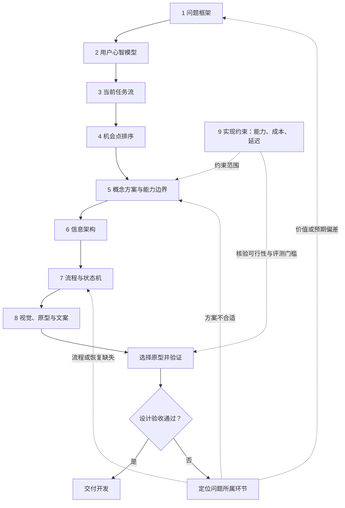

## 02｜五层模型：逐层落地，向上追因

五层用于检查产出之间的依赖关系；它与九步是同一设计工作的两种视角。

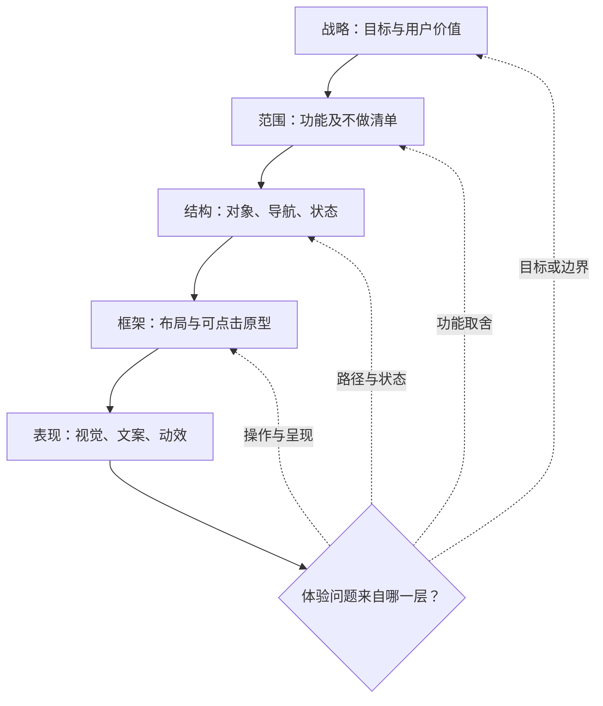

| 九步中的工作     | 对应层次  | 主要评审依据     |
| ---------- | ----- | ---------- |
| 问题框架、心智模型  | 战略    | 用户、任务、成功指标 |
| 任务流、机会点、概念 | 战略至范围 | 价值排序与能力边界  |
| 信息架构、状态机   | 结构    | 入口、权限与恢复路径 |
| 原型、视觉与文案   | 框架与表现 | 可操作性与准确表达  |
| 实现约束       | 贯穿各层  | 可实现的验收条件   |

当前层评审未通过，先修订，再向下推进。

## 03｜交互范式：按任务选择，并允许组合

下图将原文的选择维度组合成参考决策树。错误代价和用户熟练度需要再次校正选择。

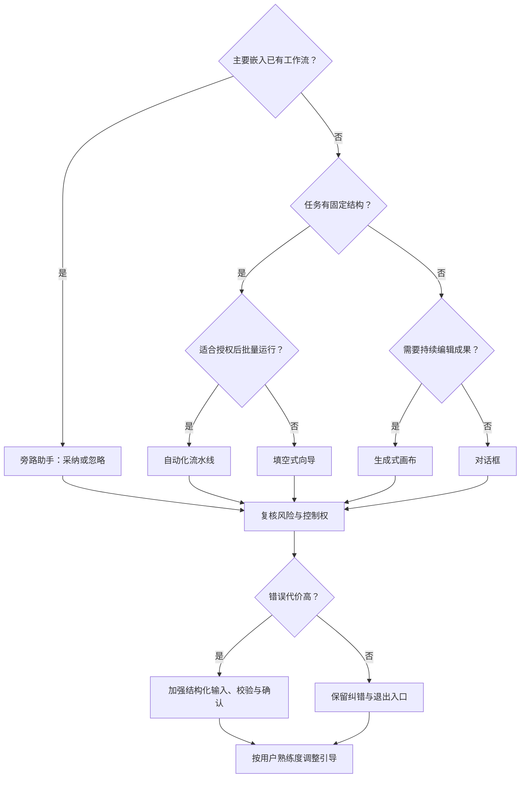

向导可负责收集信息，画布负责编辑成果，旁路助手负责局部建议。自动化界面仍需明确授权、停止与审批位置。

## 04｜信息架构：先定义对象，再补齐路径

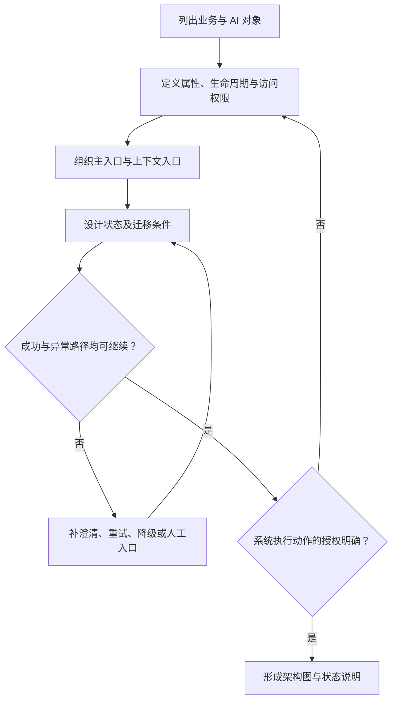

对象示例：工单、会话、建议、记忆、动作记录。动作记录还要保留审批、执行结果和用户修正。

### 工单助手：将恢复路径画进状态机

以下根据原文工单示例归并状态；实际项目应逐状态补齐异常。

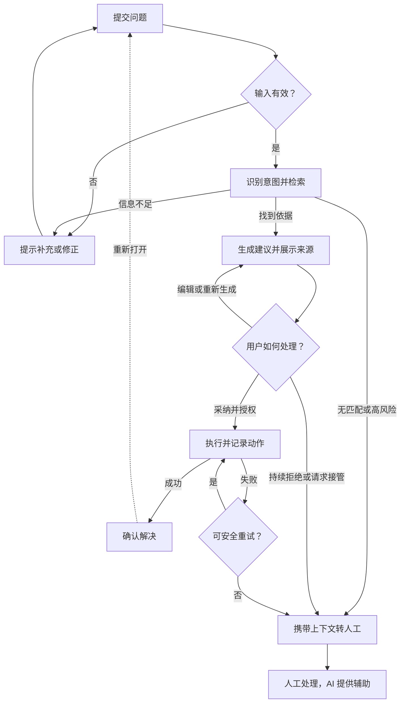

## 05｜自主性与风险：先确定权限，再决定动作

L0–L4 描述系统获得的代理权，需按任务风险与验证结果选择，不应理解为自动升级顺序。

| 等级 | 系统行为    | 界面与控制要求     |
| -- | ------- | ----------- |
| L0 | 提供建议    | 采纳、忽略       |
| L1 | 生成草稿    | 编辑、修正       |
| L2 | 确认后执行   | 动作预览、确认     |
| L3 | 限定范围内自治 | 边界、记录、停止或撤销 |
| L4 | 无人值守执行  | 审计、停用、回滚机制  |

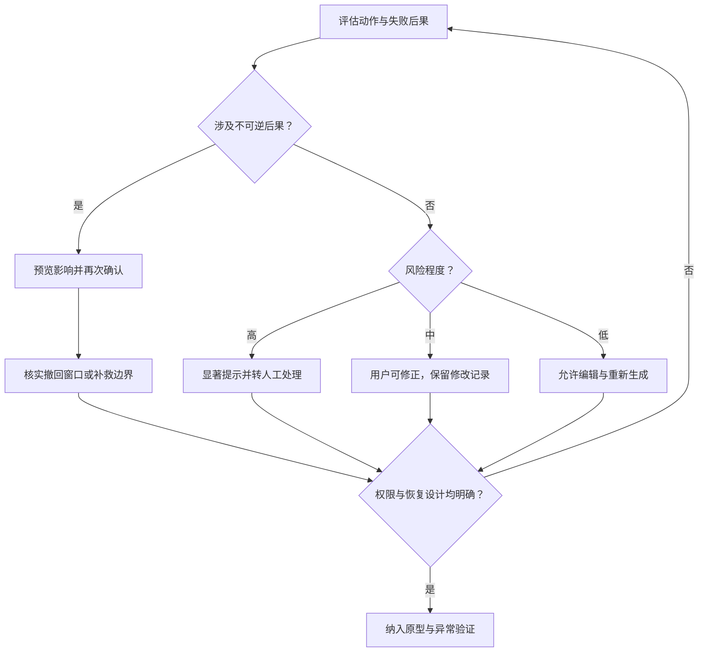

撤回窗口需结合实际能力设计；不能把已经产生的不可逆后果表述为可随时撤销。

## 06｜交互与文案：让用户理解、判断和纠正

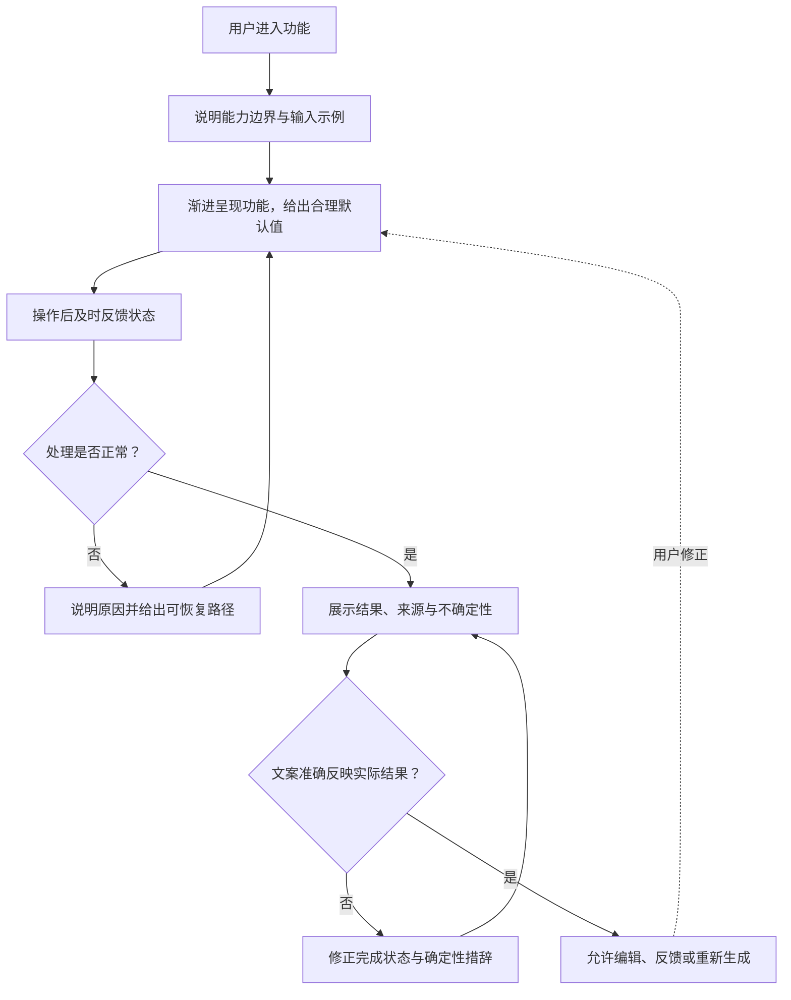

评审同时检查控件映射、一致性、输入约束和容错；覆盖空白、加载、错误、权限不足与离线状态。拒绝请求时解释原因，并提供可行的下一步。

## 07｜执行透明度、上下文与记忆

### 长任务：进度可见，用户可中止

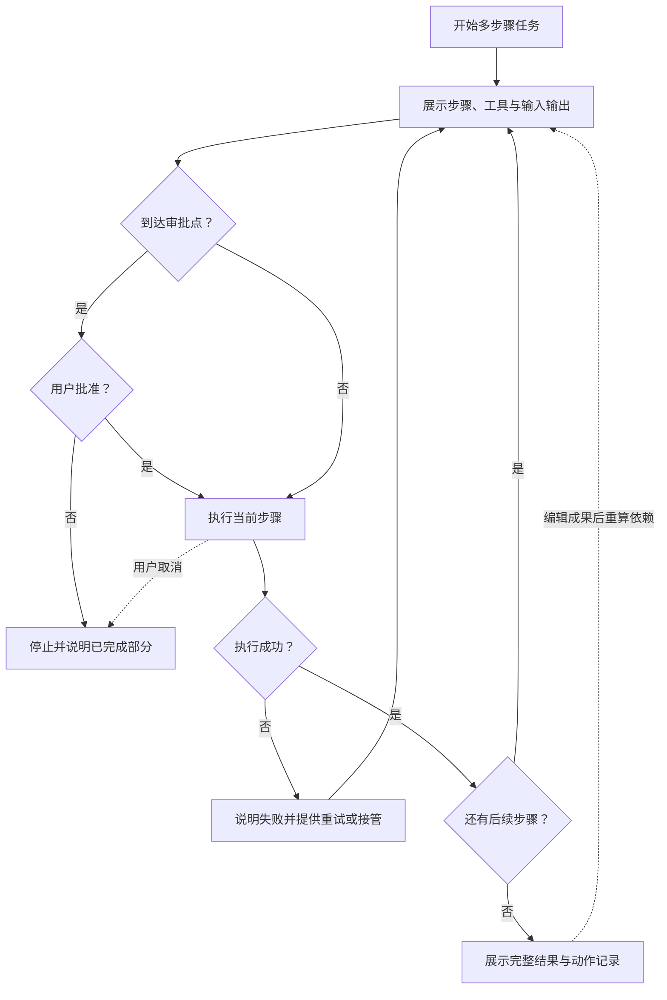

流式内容尚在变化时，应区分中间态与完整结果；多版本成果提供对比，历史动作可回放。

### 上下文与记忆：展示内容应与实际使用一致

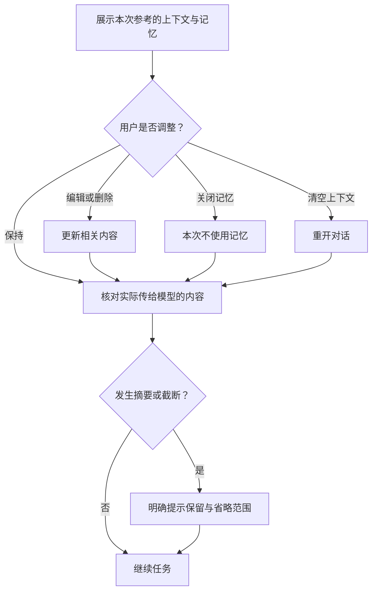

会话上下文与长期记忆应分别提供控制入口；使用记忆时让用户知道具体引用了什么。

## 08｜原型策略：先明确要验证的问题

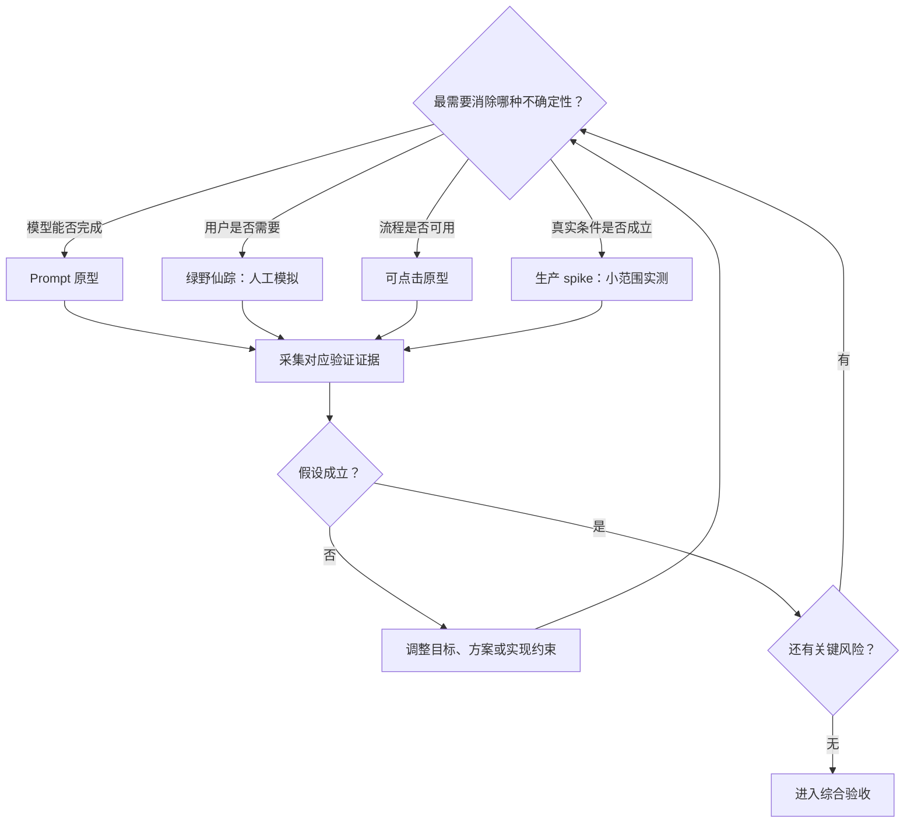

原型按验证目标选用。可点击界面不能证明模型能力，人工模拟不能证明规模化性能；工具名称不应代替验证目标。

## 09｜综合验收：用证据决定是否交付

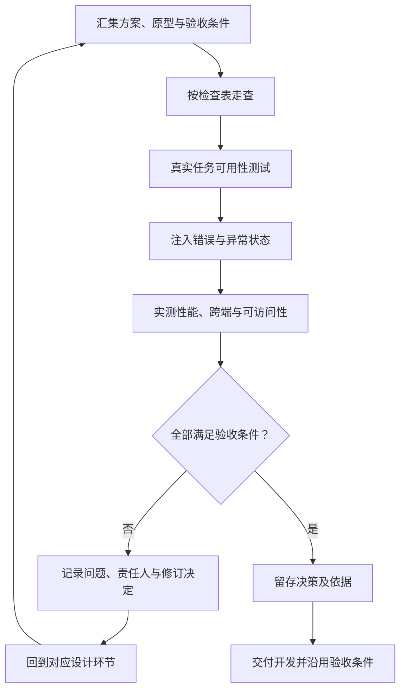

| 验证环节    | 重点证据                     |
| ------- | ------------------------ |
| 设计走查    | 能力边界、状态、权限、纠错与文案是否完整     |
| 任务测试    | 能否开始、追问、理解进度、从错误中恢复      |
| 错误注入    | 答错、超时、拒答、服务不可用、上下文超限     |
| 性能核验    | 首次响应、完整结果、工具步骤、弱网与并发     |
| 跨端与可访问性 | 主场景端、降级方案、对比度、键盘、读屏和文本替代 |

产品、设计、工程、数据或评测共同评审，按需加入合规角色。记录决策、原因、备选方案与负责人。

原文的响应时间、撤销窗口、用户样本量等数值包含示例或建议，本整理未将其改写为所有项目通用的门槛。项目应明确自身预算与验收值。

---

## 来源与改编说明

本文仅整理 [《产品设计与原型总览》](https://aipm.ac/pm/design/) 正文，未展开其链接的其他章节。流程的分组、节点压缩与部分判断分支为整理表达；工单状态图是原文示例的简化，不是完整业务规格。

原作者：AI-PM Wiki Team。原文标注采用 [CC BY-SA 4.0](https://creativecommons.org/licenses/by-sa/4.0/) 与 SATA 条款；额外条款参见原页面。本整理版以 CC BY-SA 4.0 提供，并保留上述来源和改编说明。
