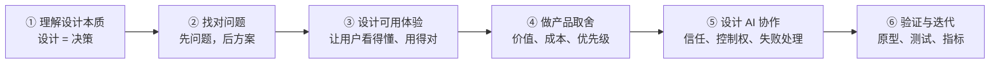
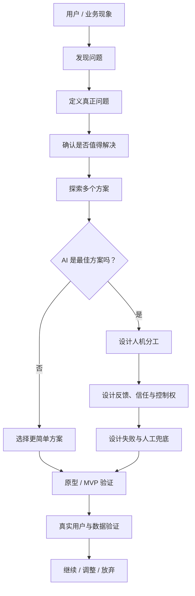
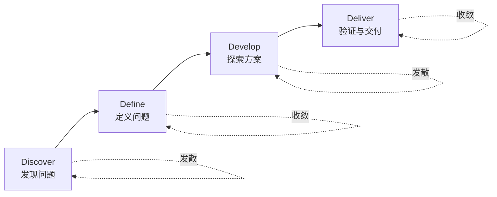
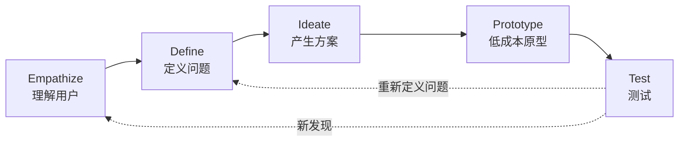
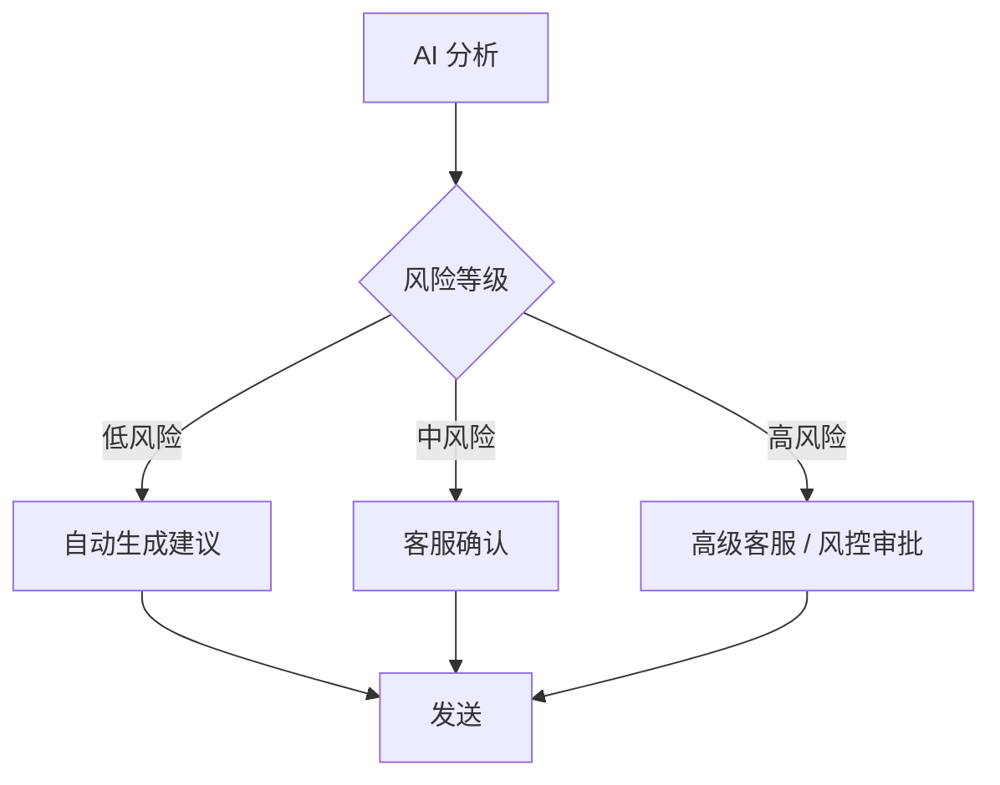
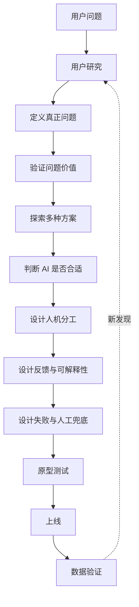
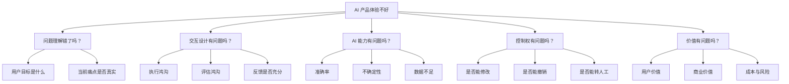

# AI 产品经理学习笔记｜设计哲学与设计思维

> 学习对象：从高级前端工程师转向 AI 产品经理  
> 原始资料：AI-PM《设计哲学与设计思维》  
> 学习目标：不是背诵设计理论，而是形成 **“发现问题 → 做设计决策 → 验证 → 控制 AI 风险”** 的产品判断能力。

---

# 0. 先看这一页：我到底要学会什么？

读完这一章，不要求记住所有设计史、人物和术语。

真正需要掌握的是下面 7 个判断：

1. **设计不是画界面，而是在信息不完整时做决策。**
2. **先证明问题值得解决，再讨论方案。**
3. **用户说的任务，不一定是用户真正的目标。**
4. **产品必须让用户知道：能做什么、怎么做、做完发生了什么。**
5. **AI 产品除了“好不好用”，还必须处理不确定性、信任、控制权和失败。**
6. **设计不是只满足用户，还要平衡用户价值、商业价值、技术约束和伦理风险。**
7. **设计最终需要被验证，而不是靠审美或个人偏好证明。**

如果这 7 条能在真实案例里用出来，这一章就算学会了。

---

# 1. 知识地图（优化版）

> 不要一开始记所有概念。先记住下面这条 **AI 产品设计主线**：  
> **理解设计 → 找对问题 → 设计体验 → 做取舍 → 设计 AI 协作 → 验证迭代**

## 1.1 先看主干：6 步学习路径



### 一句话记忆

```text
不是先画页面，
而是先找对问题；
不是只让 AI 能做，
而是让人知道 AI 在做什么、为什么、错了怎么办；
最后用真实结果验证设计。
```

---

## 1.2 再看分层：每一层到底学什么？

| 层级 | 你要回答的核心问题 | 重点概念 | 最终产出 |
|---|---|---|---|
| **① 理解设计本质** | 设计到底在解决什么？ | 设计即决策、问题求解、意义创造 | 设计判断原则 |
| **② 找对问题** | 我们真正应该解决什么？ | 双钻模型、Design Thinking、UCD、情境调查、目标 ≠ 任务 | 问题定义 / 用户目标 |
| **③ 设计可用体验** | 用户能不能理解、操作、判断结果？ | 心智模型、反馈、映射、约束、示能性与能指、执行/评估鸿沟 | 用户流程 / 交互方案 |
| **④ 做产品取舍** | 什么该做，什么不该做？ | Kano、Design Critique、Rams 原则 | 优先级 / 设计决策 |
| **⑤ 设计 AI 协作** | AI 应该做多少，人应该保留多少控制？ | 不确定性、信任校准、控制权交接、透明、问责、偏见、自主性 | 人机分工 / 风险策略 |
| **⑥ 验证与迭代** | 怎么证明设计真的有效？ | 原型、用户测试、指标、持续迭代 | 验证结论 / 下一轮决策 |

---

## 1.3 AI 产品经理最重要的一条主线

把所有概念压缩成一条产品逻辑链：



### 这张图真正要记的只有 4 个判断

1. **问题是真的吗？** —— 不要把用户提出的功能直接当需求。
2. **AI 是最佳方案吗？** —— 不要为了 AI 而 AI。
3. **人和 AI 怎么分工？** —— 自动化程度越高，控制权设计越重要。
4. **怎么证明有效？** —— 用用户行为和业务结果验证，而不是靠主观判断。

---

## 1.4 用“问题”而不是“术语”来记忆

以后看到这一章的概念，不需要逐个背，可以挂到下面 5 个问题上：

```text
Q1：我们到底在解决什么问题？
    → 双钻、Design Thinking、UCD、目标 ≠ 任务

Q2：用户为什么会看不懂 / 不会用？
    → 心智模型、反馈、能指、映射、执行/评估鸿沟

Q3：什么该优先做？
    → Kano、Design Critique、设计原则

Q4：AI 应该做到什么程度？
    → 不确定性、信任校准、控制权、人机分工

Q5：设计是否真的有效？
    → 原型、用户测试、指标、持续迭代
```

这样学习时，每遇到一个新概念，只要先问：

> **“它是在帮我回答哪一个问题？”**

知识就不容易散。

---

## 1.5 我的学习优先级

对于 AI 产品经理转型，不需要平均用力。

### P0｜必须会用：能拿来做产品判断

- 设计即决策
- 双钻模型
- 目标 ≠ 任务
- UCD
- 心智模型
- 反馈
- 执行鸿沟 / 评估鸿沟
- AI 不确定性
- 信任校准
- 人机控制权
- 失败与人工兜底

### P1｜需要理解：遇到场景知道什么时候用

- Design Thinking
- Kano
- Design Critique
- 情境调查
- 情感化设计
- 价值敏感设计
- 服务设计

### P2｜知道即可：需要时再查

- 设计史
- 具体设计运动和人物
- 各类理论的完整历史背景

## 1.6 最简记忆版

如果过一周只允许记住一张图，就记这个：

```text
找对问题
   ↓
判断值不值得做
   ↓
探索多种方案
   ↓
判断 AI 是否合适
   ↓
设计人机分工
   ↓
设计反馈 / 信任 / 控制权
   ↓
设计失败兜底
   ↓
验证真实效果
```

---

# 2. 核心概念卡片

---

## 卡片 1｜设计即决策

### 一句话

设计的核心不是“把页面做漂亮”，而是：

> 在用户价值、商业目标、技术限制和风险之间做选择。

### 产品经理真正需要回答

- 为谁设计？
- 用户真正的问题是什么？
- 做什么？
- 不做什么？
- 为什么现在做？
- 失败怎么办？
- 哪些决策可以回退？

### AI 产品里的特殊性

传统软件的行为通常比较确定。

AI 产品存在：

- 输出不稳定
- 可能产生错误
- 能力边界模糊
- 用户容易高估模型能力

因此 AI 产品设计的重点之一是：

> **不要只设计“成功路径”，还要设计“模型失败之后怎么办”。**

### 我的实践提醒

作为工程背景转产品，容易快速进入：

> “这个功能怎么实现？”

需要刻意提前问：

> **“为什么要实现？”**

---

## 卡片 2｜问题求解 vs 意义创造

### 问题求解

关注：

- 更快
- 更准
- 更省力
- 更少错误

例如：

> AI 帮客服自动查询支付订单。

### 意义创造

关注：

- 用户如何理解产品
- 产品扮演什么角色
- 用户使用它时是什么感受

例如，同样一个 AI：

- 是“自动替我做决定的机器人”
- 是“辅助判断的 Copilot”
- 是“给我建议的专家”

会产生完全不同的信任与控制感。

### AI PM 要问

> 我的 AI 是工具、助手、同事、专家，还是代理人？

这个定位会影响：

- UI
- 文案
- 权限
- 用户预期
- 错误成本

---

## 卡片 3｜双钻模型

### 一句话

**先把问题想清楚，再把方案做出来。**



### 第一个钻石：Problem Space

核心问题：

> **我们到底应该解决什么？**

方法：

- 用户访谈
- 数据分析
- 情境观察
- 用户旅程
- 痛点分析

输出：

> 清晰的问题定义。

### 第二个钻石：Solution Space

核心问题：

> **什么方案最适合解决这个问题？**

方法：

- 多方案
- 原型
- 用户测试
- MVP
- 实验

### AI PM 最常见错误

```text
发现 LLM 很强
    ↓
想做 AI Agent
    ↓
找一个业务场景套进去
```

正确顺序：

```text
发现用户问题
    ↓
判断问题价值
    ↓
分析为什么发生
    ↓
探索不同解决方案
    ↓
再判断 AI 是否是最佳方案
```

### 一句面试表达

> 我会先验证问题空间，再进入方案空间，避免“为了 AI 而 AI”。

---

## 卡片 4｜Design Thinking 五阶段



### 真正应该记住的不是 5 个单词

而是两个原则：

#### 原则 1：不要太早爱上方案

先理解问题。

#### 原则 2：原型是为了学习，不是为了展示完成度

原型越便宜，越容易推翻。

### 边界

Design Thinking 适合：

- 开启一个模糊问题
- 组织团队探索
- 快速形成共同语言

但它不能替代：

- 真实用户研究
- 数据证据
- 商业分析
- 技术验证

所以：

> **Design Thinking 是启动器，不是“方案正确”的证据。**

---

## 卡片 5｜UCD：以人为中心设计

### 核心思想

产品设计不能建立在“我觉得用户会这样用”上。

需要：

1. 理解用户、任务和环境
2. 让用户参与
3. 用用户评价驱动迭代
4. 持续迭代
5. 看完整体验
6. 多角色共同参与

### AI 时代需要扩大“用户”的范围

除了直接用户，还可能包括：

- 被 AI 决策影响的人
- 客服
- 运营
- 审核人员
- 风控人员
- 管理者

### AI PM 判断题

如果 AI 帮客服自动拒绝退款：

> 谁是这个产品的用户？

不能只回答：

> 客服。

还需要考虑：

> 被拒绝退款的消费者也是被系统影响的人。

---

## 卡片 6｜目标 ≠ 任务

### 任务

用户正在做什么。

例如：

> 客服不断复制订单号到不同系统查询。

### 目标

用户真正想完成什么。

例如：

> 快速、准确地判断这笔支付为什么失败，并给用户明确解释。

### 为什么非常重要？

如果只看任务：

> 做一个“一键复制订单号”的功能。

如果看目标：

可能发现更好的方案是：

> 系统自动聚合订单、支付、退款和风控信息。

### 学习公式

```text
用户行为
↓
用户任务
↓
为什么要做？
↓
最终目标
↓
真正需求
```

---

# 3. 最容易混淆的概念：对比表

## 3.1 Design Thinking vs 双钻模型

| 维度 | Design Thinking | 双钻模型 |
|---|---|---|
| 强调 | 人本探索与迭代 | 发散与收敛 |
| 核心问题 | 怎样理解用户并快速试验 | 当前是在问题空间还是方案空间 |
| 最有价值的地方 | 指导探索过程 | 防止过早进入方案 |
| AI PM 用法 | 做用户探索、原型测试 | AI 需求评审守门 |

---

## 3.2 UCD vs UXD vs 产品设计

| 概念 | 主要回答 |
|---|---|
| UCD | 我们应该怎样围绕人进行设计？ |
| UXD | 用户完整体验应该怎样被设计？ |
| 产品设计 | 用户、商业、技术之间应该怎样取舍？ |

### 对 AI PM 的启发

用户喜欢，并不代表产品值得做。

技术能做，也不代表应该做。

产品经理最终需要回答：

> **用户价值 × 商业价值 × 技术可行 × 风险可控，是否同时成立？**

---

## 3.3 Affordance vs Signifier

### Affordance

“客观上能不能做”。

### Signifier

“用户知不知道可以这样做”。

数字产品里，产品经理更常遇到的是 **Signifier 不足**。

例如：

> 一个文字区域实际上可以点击，但用户看不出来。

这不是“不能点击”。

而是：

> 没有足够线索告诉用户它可以点击。

---

## 3.4 执行鸿沟 vs 评估鸿沟

| 类型 | 用户的问题 |
|---|---|
| 执行鸿沟 | 我知道自己想干什么，但不知道怎么操作 |
| 评估鸿沟 | 我操作了，但不知道系统发生了什么 |

AI 产品尤其容易出现 **评估鸿沟**。

例如：

用户点击：

> “分析支付失败原因”

AI 输出：

> “交易可能因为风险原因失败。”

用户接下来会问：

- 为什么？
- 查了哪些数据？
- 这个结论可靠吗？
- 我应该怎么处理？

如果产品无法回答，评估鸿沟就很大。

---

# 4. 认知设计：评审产品时怎么用？

## 4.1 反馈

用户做完动作，系统必须告诉用户：

```text
收到操作
↓
正在处理
↓
当前状态
↓
处理结果
↓
下一步能做什么
```

### AI 产品特别需要反馈

因为 AI 可能等待数秒甚至更久。

例如不要只有：

> 正在思考……

而应该尽可能表达：

```text
正在读取订单信息
↓
正在检查支付状态
↓
正在匹配异常规则
↓
已生成分析结果
```

注意：

不能假装展示模型实际上没有执行的步骤。

---

## 4.2 约束

设计不仅告诉用户“可以做什么”，也需要阻止危险操作。

AI 产品常见：

```text
低风险动作
AI 可直接执行

中风险动作
AI 建议 → 用户确认

高风险动作
AI 建议 → 人工审批 → 执行
```

例如：

| 操作 | 推荐 |
|---|---|
| 查询订单 | AI 自动 |
| 生成客服回复 | AI 生成，人工确认 |
| 发起退款 | 人工确认 |
| 大额资金操作 | 多级审批 |

---

## 4.3 心智模型

设计者认为 AI：

> 一个概率模型，有明确边界。

用户可能认为 AI：

> 一个什么都知道的智能专家。

两者差距越大，风险越高。

因此 AI 产品需要主动告诉用户：

- AI 能做什么
- AI 不能做什么
- 数据来自哪里
- 什么时候可能出错
- 用户什么时候需要人工判断

---

# 5. Kano：怎么决定先做什么？

## 五种需求

| 类型 | 含义 | 产品策略 |
|---|---|---|
| 基本型 | 没有就很不满 | 必须保证 |
| 期望型 | 做得越好越满意 | 持续优化 |
| 兴奋型 | 没想到，但有了很惊喜 | 做差异化 |
| 无差异型 | 做不做都无所谓 | 少投入 |
| 反向型 | 做了反而不喜欢 | 谨慎 / 可关闭 |

## AI 产品里的典型例子

“AI 自动执行退款”：

对追求效率的人：

> 可能是期望型。

对资金风险敏感的运营人员：

> 可能是反向型。

所以：

> **需求类型不是功能固有属性，而取决于用户和场景。**

---

# 6. 情感化设计：AI 为什么尤其重要？

AI 通过语言和用户交流，因此天然带有“人格感”。

产品经理需要决定三个东西：

## Persona

AI 是谁？

- 助手
- 同事
- 顾问
- 专家
- Agent

## Tone

不同场景怎么说话？

例如：

成功：

> 已完成订单状态检查。

高风险：

> 当前信息不足，暂不建议自动退款。

错误：

> 暂时无法确认失败原因，需要人工进一步检查。

## 拟人化程度

最重要的原则：

> 可以像人一样自然交流，但必须像系统一样诚实表达能力边界。

不要为了让用户“喜欢 AI”，刻意制造不存在的：

- 情绪
- 理解力
- 记忆能力
- 确定性

---

# 7. 设计伦理：AI PM 必须加的一层

传统产品：

```text
用户体验
+ 商业价值
+ 技术可行
```

AI 产品还需要：

```text
透明
+ 可问责
+ 公平
+ 用户自主性
```

## 四个检查问题

### 透明

用户知道：

> 自己正在和 AI 交互吗？

### 问责

AI 做错后：

> 能找到原因和负责人吗？

### 偏见

模型或界面：

> 会不会系统性影响某一类用户？

### 自主性

用户：

> 能不能拒绝 AI、修改 AI、退出 AI？

---

# 8. AI 产品设计的 4 个新核心问题

这部分是整篇文章对 AI PM 最重要的内容之一。

## 8.1 不确定性表达

传统程序：

```text
成功 / 失败
```

AI：

```text
可能正确
可能部分正确
可能错误
可能缺少信息
```

产品需要回答：

> 怎么让用户感知这种不确定性？

可使用：

- 引用来源
- 信息缺失提醒
- 风险等级
- 建议人工确认
- 明确“推测”与“事实”

---

## 8.2 信任校准

目标不是：

> 让用户越相信 AI 越好。

而是：

> **用户的信任程度 ≈ AI 的真实能力。**

两种失败：

```text
AI 能力 60%
用户信任 95%
→ 盲从

AI 能力 90%
用户信任 20%
→ 不使用
```

真正需要的是：

> Trust Calibration。

---

## 8.3 控制权交接

需要明确：

```text
什么时候 AI 做？
↓
什么时候人确认？
↓
什么时候必须转人工？
↓
用户怎么撤销？
```

这会直接影响 Agent 产品设计。

---

## 8.4 长期关系

AI 产品可能：

- 记住用户
- 学习用户偏好
- 改变模型
- 更新能力

因此产品还需要设计：

- 记忆管理
- 删除记忆
- 能力变化提示
- 版本变化
- 用户控制

---

# 9. 把整章知识用到一个案例

# Case：支付异常处理 AI Copilot

## 背景

客服每天处理大量：

> “为什么我的支付失败？”

当前流程：


问题：

- 系统多
- 查询慢
- 新客服不熟悉规则
- 错误解释可能引发投诉

---

# 10. 第一钻：先研究问题，不要急着做 Agent

## Discover

需要调查：

### 用户访谈

问客服：

- 最近一次处理支付失败是什么情况？
- 最耗时的是哪一步？
- 哪些问题最难判断？
- 你通常去哪里找答案？
- 什么情况下必须找高级客服？

### 行为数据

查看：

- 平均处理时长
- 转人工比例
- 一次解决率
- 不同异常类型占比

### 情境调查

直接观察客服处理一次真实订单。

---

## Define

最终可能得到：

> 客服真正的问题并不是“缺一个 AI 聊天框”。

而是：

> 订单信息分散在多个系统，客服需要根据复杂规则人工整合判断，导致处理时间长且新人错误率高。

### POV

```text
用户：
支付客服

需要：
快速判断支付失败原因

因为：
信息分散 + 规则复杂 + 经验依赖高
```

---

# 11. 第二钻：探索解决方案

不要直接决定做 Agent。

先发散：

### 方案 A
统一订单查询页面。

### 方案 B
支付异常规则引擎。

### 方案 C
知识库搜索。

### 方案 D
AI Copilot 自动查询 + 总结。

### 方案 E
Agent 自动查询并执行处理。

然后比较：

| 方案 | 价值 | 风险 | 成本 |
|---|---|---|---|
| 统一页面 | 高 | 低 | 中 |
| 规则引擎 | 高 | 低 | 中 |
| AI 搜索 | 中 | 中 | 低 |
| AI Copilot | 高 | 中 | 中 |
| 全自动 Agent | 高 | 高 | 高 |

产品经理的价值不是：

> 想出 Agent。

而是：

> **能说明为什么最终选择 Copilot，而不是其他方案。**

---

# 12. 设计 Copilot

## Step 1：建立正确心智模型

页面明确：

> AI 会根据订单、支付状态和知识库生成辅助判断，结果仅供客服参考。

不要写：

> AI 智能专家将为你准确判断。

---

## Step 2：减少执行鸿沟

客服只需要输入：

```text
订单号
```

系统自动：

```text
订单
↓
支付
↓
退款
↓
风险信息
↓
知识库
```

---

## Step 3：减少评估鸿沟

AI 不只输出：

> 疑似风控拒绝。

而是：

```text
判断：
疑似风险规则触发

依据：
1. 支付网关状态：DECLINED
2. 风控规则：RISK_102
3. 用户当天连续失败 4 次

建议：
暂不建议重复支付，建议用户 30 分钟后重试。

置信程度：
信息较完整，但最终风控原因需要人工确认。
```

---

# 13. 控制权设计



### 核心原则

> AI 能力越强，控制权设计越重要。

---

# 14. 伦理检查

上线前问：

### Transparency
用户 / 客服是否知道哪些结论由 AI 生成？

### Accountability
AI 判断错误后，是否有日志可以追溯？

### Bias
风控信息是否可能导致 AI 对特定用户产生不合理推断？

### Autonomy
客服能否：

- 不采用 AI 建议？
- 修改 AI 回复？
- 转人工？
- 查看原始数据？

---

# 15. 用 Kano 做优先级

### Must-be

- 查询结果准确
- 不泄露敏感信息
- 权限正确
- 高风险操作必须确认

### One-dimensional

- 分析速度
- 原因判断准确率
- 建议质量

### Attractive

- 自动生成用户可理解的话术
- 自动总结复杂异常链路

第一版产品不应该为了“惊艳”牺牲基本能力。

---

# 16. 这个案例的一条完整产品逻辑链



这条链比“需求 → PRD → 开发 → 上线”更适合 AI 产品。

---

# 17. 问题树：遇到 AI 产品设计题时怎么拆



以后做产品分析，可以先跑这棵树。

---

# 18. 设计评审 Checklist

以后看到一个 AI 产品，可以逐项检查。

## Problem

- [ ] 用户真正的目标是什么？
- [ ] 问题有证据吗？
- [ ] AI 真的是最合适的方案吗？

## Interaction

- [ ] 用户知道怎么开始吗？
- [ ] 系统状态清楚吗？
- [ ] AI 为什么这么回答，用户能理解吗？
- [ ] 用户知道下一步做什么吗？

## AI

- [ ] 能力边界明确吗？
- [ ] 不确定性是否被表达？
- [ ] AI 错了怎么办？
- [ ] 有没有人工兜底？

## Control

- [ ] 用户能修改吗？
- [ ] 用户能拒绝吗？
- [ ] 用户能撤销吗？
- [ ] 高风险操作是否需要确认？

## Ethics

- [ ] 是否明确 AI 身份？
- [ ] 是否可追溯？
- [ ] 是否可能放大偏见？
- [ ] 是否保留用户自主权？

## Business

- [ ] 用户价值是什么？
- [ ] 能否量化？
- [ ] 商业价值是什么？
- [ ] 成本是否合理？

---

# 19. 设计决策记录模板

这是最值得养成的习惯之一。

```markdown
## Decision

### 问题
我们要解决什么？

### 用户证据
为什么认为这是问题？

### 方案
有哪些候选方案？

### 最终选择
选择哪个？

### 原因
为什么？

### 放弃方案
为什么不选其他方案？

### 风险
可能失败在哪里？

### 回退方案
失败以后怎么办？

### 验证指标
上线后怎么知道判断正确？
```

设计评审的重点不是：

> “这个页面好不好看？”

而应该是：

> “这个决策依据是什么？”

---

# 20. 一页纸总结

## 设计的本质

```text
现状
↓
理解人
↓
定义问题
↓
探索方案
↓
做出决策
↓
低成本验证
↓
获得证据
↓
重新决策
```

## AI 产品需要额外加入

```text
不确定性
+
信任
+
控制权
+
失败处理
+
责任
```

## 一个 AI PM 的设计公式

```text
好 AI 产品设计

= 正确的问题
× 合适的 AI 能力
× 清晰的人机分工
× 可理解的反馈
× 可控制的风险
× 可验证的价值
```

任何一个接近 0，产品整体价值都会很低。

---

# 21. 主动回忆题

学习完成后，先关闭文档再回答。

## Level 1｜概念

1. 为什么说“设计的核心是决策，而不是界面”？
2. Design Thinking 最重要的两个原则是什么？
3. 双钻模型为什么能防止“为了 AI 而 AI”？
4. UCD 和产品设计有什么区别？
5. 用户“目标”和“任务”的区别是什么？
6. 执行鸿沟和评估鸿沟分别是什么？
7. 为什么 AI 产品特别容易产生评估鸿沟？
8. 什么叫信任校准？
9. 为什么 AI 能力越强，控制权设计越重要？
10. 为什么“用户越信任 AI 越好”是错误的？

## Level 2｜判断

### 场景 1

用户说：

> “我想要一个 AI 自动帮我退款。”

回答：

- 这是需求还是解决方案？
- 应该继续问什么？
- 哪些情况下不应该自动退款？

### 场景 2

AI 输出：

> “建议拒绝该用户退款。”

但没有说明依据。

回答：

- 这里主要是什么设计问题？
- 属于执行鸿沟还是评估鸿沟？
- 怎么改？

### 场景 3

团队说：

> “竞品都已经做 Agent，我们也必须做。”

你应该如何用双钻模型反驳？

---

# 22. 面试表达训练

## Q：你如何设计一个 AI 产品？

不要回答：

> 需求分析 → PRD → 原型 → 开发 → 上线。

可以回答：

> 我会先把问题空间和方案空间分开。首先通过用户研究、行为数据和业务指标确认问题是否真实、是否值得解决，再定义用户的目标，而不是直接接受用户提出的功能方案。进入方案空间后，我会同时比较非 AI 和 AI 方案。如果 AI 确实有优势，再重点设计人机分工、不确定性表达、控制权、失败兜底和可解释性，最后通过低成本原型和真实用户测试验证，并在上线后用业务指标和体验指标持续迭代。

这段表达体现的不是“会背流程”，而是：

> 有产品判断框架。

---

# 23. 针对工程背景转 AI PM 的学习重点

你已经有较强的工程和交互实现经验，所以不需要把主要精力继续放在：

- 页面怎么实现
- 技术链路怎么搭
- 一个功能能不能做出来

更需要刻意训练：

## 1. 从“实现”切换到“问题”

看到方案先问：

> 它到底解决什么问题？

## 2. 从“可行性”切换到“价值判断”

工程师常问：

> 能不能做？

PM 还要问：

> 值不值得做？

## 3. 从“正常路径”切换到“决策与失败”

AI 产品尤其需要问：

> AI 错了怎么办？

## 4. 从“功能”切换到“人机关系”

不要只设计：

> AI 有哪些功能。

还要设计：

> 人什么时候决定，AI 什么时候决定？

---

# 24. 推荐学习动作

不要重新通读这篇笔记很多遍。

## 第一次

理解知识地图。

目标：

> 能说出整个领域有哪些模块。

## 第二次

只学习 P0 概念。

目标：

> 能解释并举例。

## 第三次

关闭资料，重新画：

```text
双钻
AI 产品设计 4 个新问题
支付 Copilot 案例
```

## 第四次

自己重新做一个案例：

> AI 退款助手。

不要看答案。

完整回答：

1. 用户是谁？
2. 用户目标是什么？
3. 当前问题是什么？
4. 有什么证据？
5. 有哪些非 AI 方案？
6. 为什么使用 AI？
7. AI 做什么？
8. 人做什么？
9. AI 错了怎么办？
10. 怎么衡量效果？

如果可以独立回答这 10 个问题，这一章已经从“知识”开始变成“能力”。

---

# 25. 我的复盘区

每次练习后填写。

## 今天我真正理解了什么？

-

## 哪个概念我仍然解释不清？

-

## 哪个地方我只是记住了结论，没有理解原因？

-

## 今天的知识能解决什么产品问题？

-

## 如果面试官现在问我，我能举什么案例？

-

## 下一次我要重点练什么？

-

---

# 26. 最终记忆卡

只记这几句话：

> **设计 = 决策，不是画图。**

> **先研究问题，再选择方案。**

> **用户要的是目标，不是任务。**

> **原型的目的，是用最低成本获得新知识。**

> **好的 AI 设计，不只让模型“能做事”，还要让用户知道它在做什么、为什么这样做、错了怎么办。**

> **AI 不是越自动越好，真正重要的是合适的人机分工。**

> **信任不是越高越好，而是与系统真实能力匹配。**

> **最终用真实用户行为和业务结果验证设计，而不是用个人偏好证明设计。**

---

# 资料来源

本文是基于 AI-PM《设计哲学与设计思维》的学习重构版，并结合 AI 产品经理学习目标和支付业务案例重新组织，不是原文逐段摘录。

原文：
https://aipm.ac/pm/design-philosophy/

建议后续与以下主题一起学习：

1. 用户研究
2. 需求分析
3. 产品设计与原型
4. 数据分析
5. AI 产品评测
6. Agent 人机协作与权限设计
