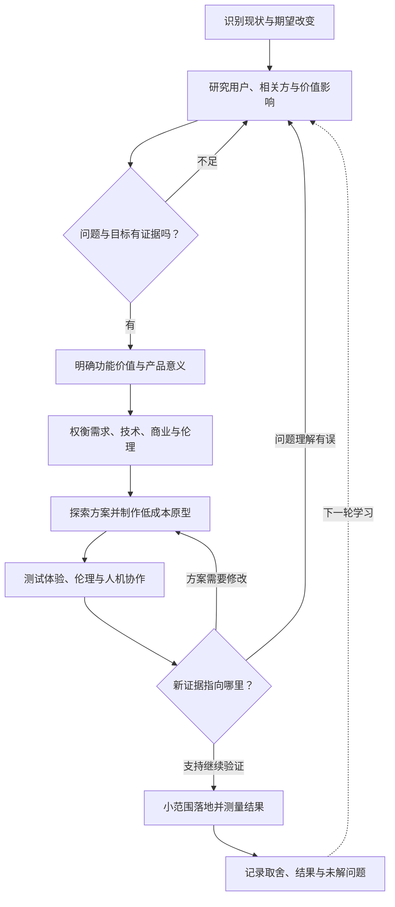
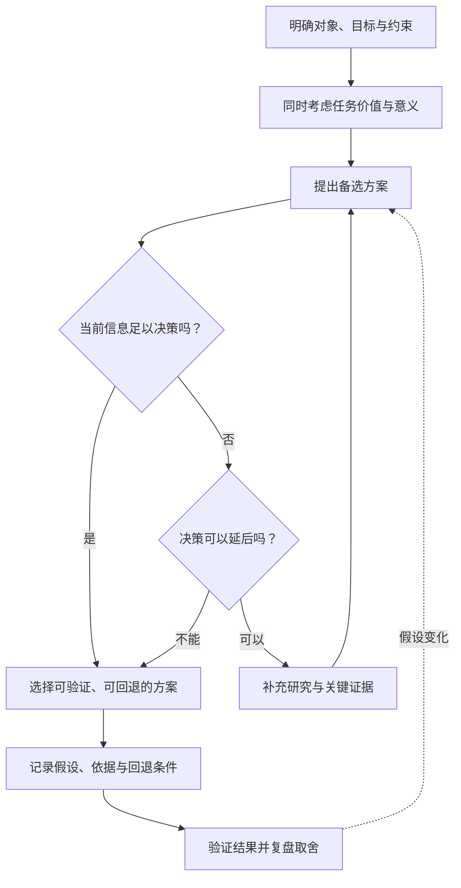
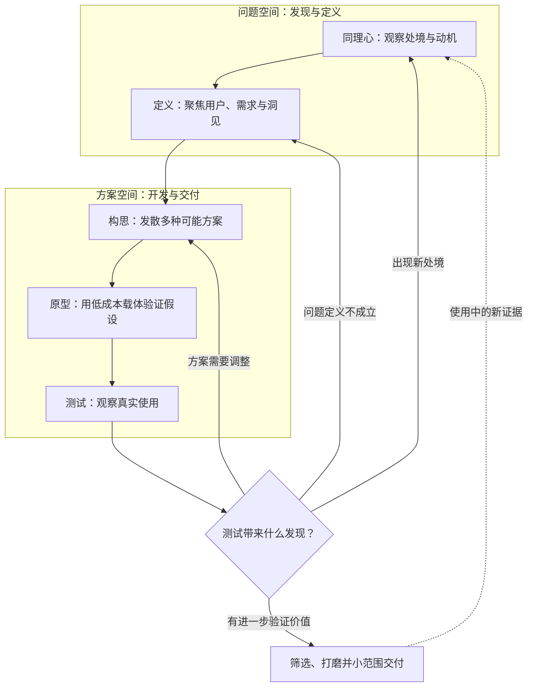
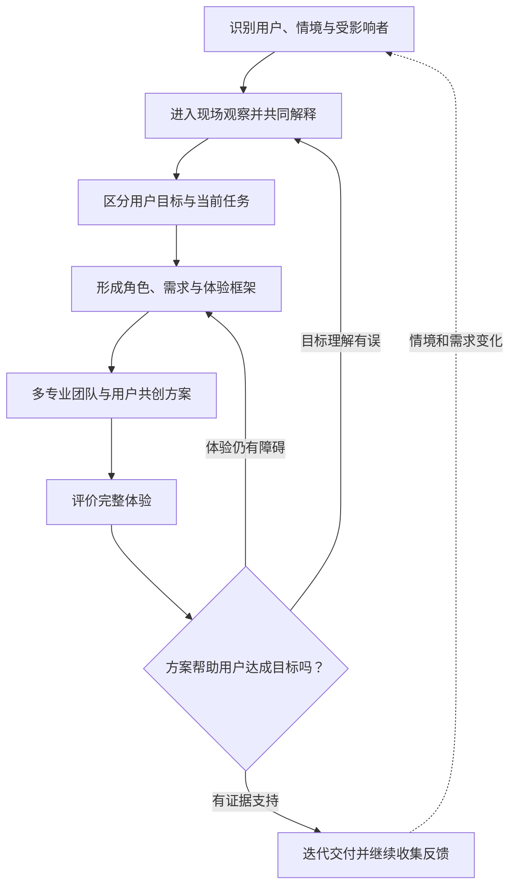
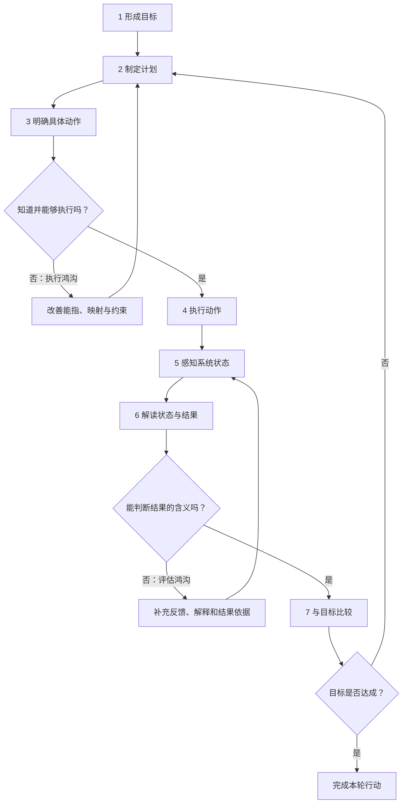
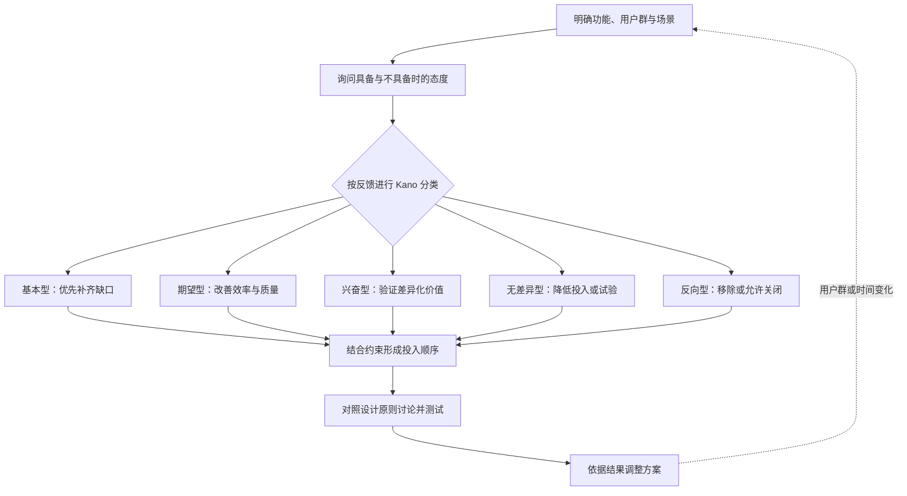
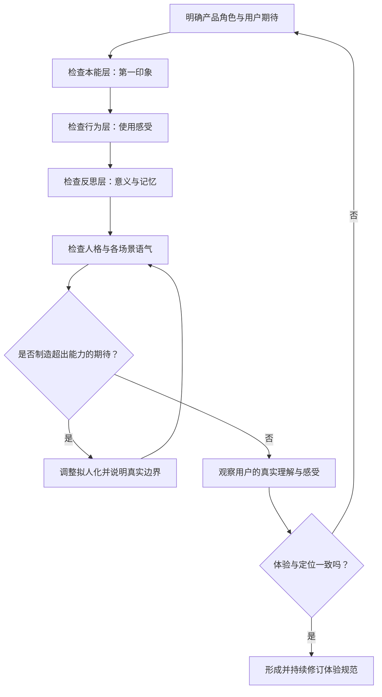
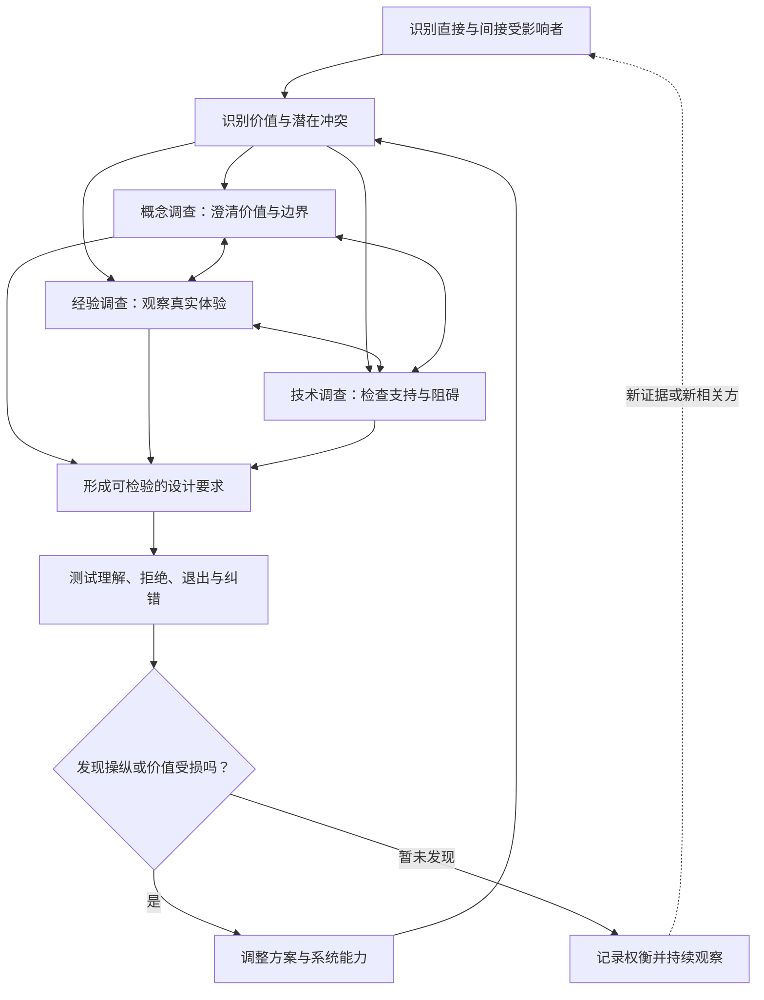
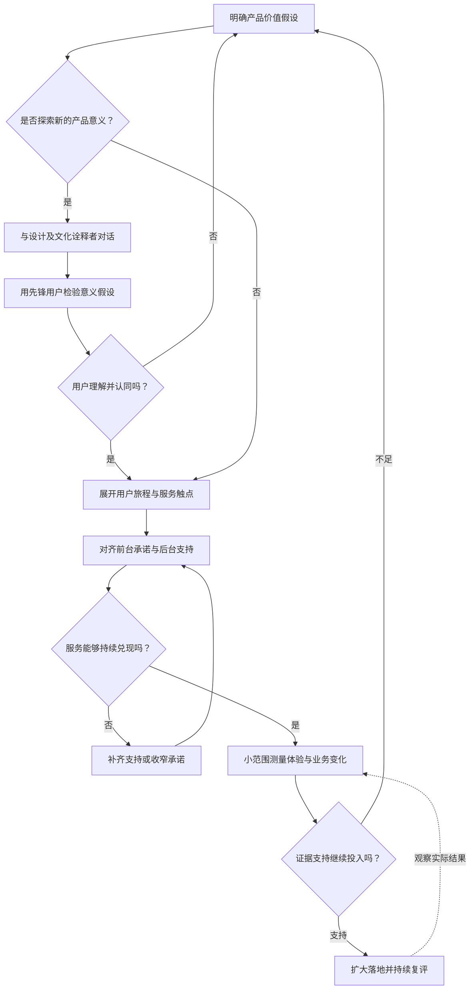
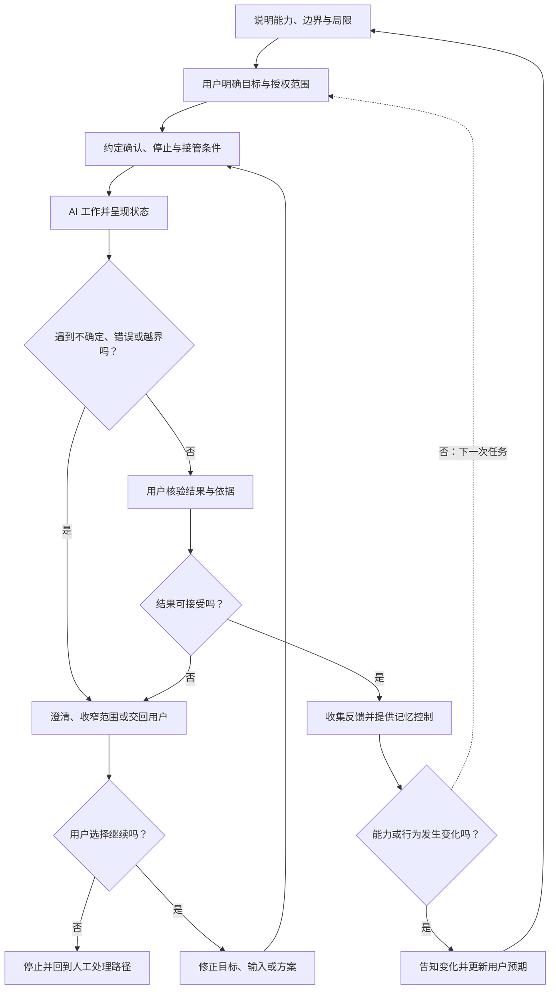

# 设计哲学与设计思维：流程图整理

> **原文**：[AI-PM《设计哲学与设计思维》][S1]  
> **原作者与项目**：AI-PM Wiki 贡献者 / [AI-PM-Wiki/AIPM][S2]  
> **整理日期**：2026-11-07  
> **阅读方式**：先看总流程，再按问题查阅分主题流程。所有图均使用 Mermaid，可在支持 Mermaid 的 Markdown 编辑器中渲染。

**整理说明**：本文按原文的九个主题重组，共包含 **10 张流程图**。概念与方法来自原文；图中的具体判断分支、连接顺序与产出提示是为了学习和实践而补充的组织方式，不代表原文规定了一条唯一流程。用户参与、伦理、商业约束需要贯穿全过程；图中的回路表示可以根据新证据返回前序步骤。两处经官方资料核对的校正在文末说明。

## 目录

- [0. 总流程：把设计思想串成决策闭环](#0-总流程把设计思想串成决策闭环)
- [1. 设计是什么：做出有依据且可回退的决策](#1-设计是什么做出有依据且可回退的决策)
- [2. 设计思维：先理解问题，再探索方案](#2-设计思维先理解问题再探索方案)
- [3. 以用户为中心：从真实目标推导需求](#3-以用户为中心从真实目标推导需求)
- [4. 认知与设计：跨越执行和评估鸿沟](#4-认知与设计跨越执行和评估鸿沟)
- [5. 好设计的标准：排优先级，审查设计依据](#5-好设计的标准排优先级审查设计依据)
- [6. 情感化设计：让体验、意义与能力一致](#6-情感化设计让体验意义与能力一致)
- [7. 设计伦理：把价值要求放进全过程](#7-设计伦理把价值要求放进全过程)
- [8. 设计与商业：让价值主张可以兑现和验证](#8-设计与商业让价值主张可以兑现和验证)
- [9. AI 时代：设计可理解、可接管的协作关系](#9-ai-时代设计可理解可接管的协作关系)
- [10. 来源、校正与许可](#10-来源校正与许可)

## 0. 总流程：把设计思想串成决策闭环

这张图把原文的思想框架整理成一条实践主线：理解处境、确认问题、探索方案、获得证据，再根据证据调整决策。它用于串联阅读，不替代具体项目的方法选择。[原文][S1]

| 设计时的核心问题 | 对应思想 | 建议留下的证据或产出 |
| --- | --- | --- |
| 谁处在什么情境中，想得到什么？ | UCD、目标导向、情境调查 | 观察记录、目标与问题陈述 |
| 产品改善什么，也表达什么？ | 问题求解、意义创造 | 价值假设、产品角色 |
| 为什么选择这个方案？ | 设计即决策、设计思维 | 候选方案、取舍理由、原型 |
| 用户能否操作、判断、纠错？ | 认知设计、好设计标准 | 可用性发现、改进依据 |
| 谁受影响，谁能拒绝，谁负责？ | 价值敏感设计、AI 伦理 | 价值权衡、控制与责任约定 |
| 服务能否兑现，效果是否成立？ | 服务设计、商业验证 | 前后台对应关系、结果数据 |

## 1. 设计是什么：做出有依据且可回退的决策

设计持续回答“为谁做、做什么、怎样呈现、失败后如何处理”。在信息不充分时，应关注决策的可逆性，并保留判断依据和回退路径。[原文：设计是什么][S1]

### 两种价值需要同时考虑

| 维度 | 核心问题 | 在 AI 产品中的落点 |
| --- | --- | --- |
| 问题求解 | 用户能否更省力、更准确地达成目标？ | 任务效果、效率、容错、可用性 |
| 意义创造 | 产品帮助用户表达什么价值、形成什么身份或关系？ | AI 是助手、教练还是同事；用户如何理解自己的角色 |

两者是并存的设计视角，不能理解为先完成全部功能、最后再附加意义。

### 设计史：理解今天的设计为何不断扩展

| 原文梳理的阶段 | 延续到今天的关注点 |
| --- | --- |
| 包豪斯 | 功能、工业生产、大众使用 |
| 现代主义与国际主义 | 理性秩序、网格、简洁 |
| 人本设计与参与式设计 | 用户经验、参与和共同决策 |
| 体验经济与体验设计 | 整体体验、服务和情感 |
| 设计思维的推广 | 可学习的流程、工具与跨专业协作 |
| AI 时代 | 人与模型之间的分工、控制和责任 |

这些关注点不断叠加，后来的思想并未让此前的设计问题消失。

## 2. 设计思维：先理解问题，再探索方案

### 五阶段与双钻如何对齐

下图用 d.school 五阶段展示学习回路，用双钻的两个空间说明“在哪里发散、在哪里收敛”。两者可以互相参照，但并非严格的一一映射。[原文：设计思维][S1]；[Design Council 官方双钻说明][S3]

| 双钻阶段 | 思考方式 | 与五阶段的主要联系 | 关键产出 |
| --- | --- | --- | --- |
| Discover：发现 | 打开问题空间 | 同理心研究 | 用户故事、情境、洞察 |
| Define：定义 | 收敛问题空间 | 定义问题 | POV 问题陈述、设计方向 |
| Develop：开发 | 打开方案空间 | 构思、原型及早期测试 | 多个候选方案与可体验原型 |
| Deliver：交付 | 收敛方案空间 | 测试、取舍与打磨 | 经验证的选择和后续改进依据 |

**POV** 可用“用户、需求、洞见”的组合组织；**How Might We** 用于把问题改写成可以探索的设计机会。原型的价值在于让假设可被讨论和检验，每一轮应明确要验证的关键问题。

### IDEO 提醒设计同时面对三类约束

| 维度 | 要问的问题 |
| --- | --- |
| 用户需求 | 用户是否需要、愿意使用？ |
| 技术可行性 | 现有能力能否可靠支持？ |
| 商业可行性 | 是否值得投入，能否持续交付？ |

IDEO 的贡献还包括把设计方法整理成可学习、可协作使用的工具。对 AI 产品而言，AI 可以帮助构思和制作原型；真实用户研究与问题验证仍需落实。

**使用边界**：完成工作坊、访谈模板或五阶段流程，并不能证明方案有效。设计思维帮助启动探索，结论仍要由研究和测试支撑。对复杂社会问题，还要识别流程之外的权力、结构和长期影响。

## 3. 以用户为中心：从真实目标推导需求

用户执行的任务是实现目标的手段。先弄清用户想完成什么、想怎样感受以及在意的长期价值，才能判断哪些任务值得自动化。[原文：以用户为中心的设计][S1]

### 三层目标：任务完成得快，未必满足全部目标

| 目标层次 | 要理解什么 | 对 AI 设计的启发 |
| --- | --- | --- |
| 体验目标 | 用户希望怎样感受？ | 保留掌控感、理解感和被尊重的感受 |
| 最终目标 | 用户希望完成什么？ | 关注最终结果，减少无意义操作 |
| 人生目标 | 用户希望成为怎样的人？ | 当用户希望学习或成长时，考虑引导和辅助 |

### 六项过程原则

| 原文归纳的 UCD 原则 | 流程中的落实方式 |
| --- | --- |
| 理解用户、任务和环境 | 以调查和观察支撑问题定义 |
| 用户持续参与 | 在研究、共创、测试等环节引入用户 |
| 用户评价驱动改进 | 用评价结果改变方案 |
| 迭代 | 允许回到研究、定义与原型 |
| 覆盖完整体验 | 包括服务、情绪、品牌与使用前后 |
| 多学科视角 | 让研究、设计、工程和业务共同参与 |

### 三个容易混淆的概念

| 概念 | 性质 | 主要回答 |
| --- | --- | --- |
| UCD | 设计过程原则 | 如何让人的处境和评价影响设计？ |
| UXD | 体验设计的专业范围 | 研究、信息架构、交互和视觉如何共同形成体验？ |
| 产品设计 | 综合决策框架 | 怎样权衡用户价值、技术约束与商业目标？ |

这三者相互配合，不是三个依次执行的阶段。

### 两种研究与参与方式

| 方法 | 怎么做 | 适用提醒 |
| --- | --- | --- |
| 参与式设计 | 用户加入方案讨论、原型制作与决策 | 适合需要长期协作的重大变革，投入较大 |
| 情境调查 | 在真实现场观察，以伙伴关系追问，确认解释并围绕研究焦点取证 | 特别适合观察用户实际怎样与 AI 协作 |

## 4. 认知与设计：跨越执行和评估鸿沟

Norman 的七阶段行动循环提供了一条检查路径：用户从目标走向操作，再从系统表现判断目标是否实现。执行鸿沟对应“怎么做”，评估鸿沟对应“发生了什么、是否达到目标”。[原文：认知与设计][S1]

### 从问题定位到设计动作

| 概念 | 需要区分的含义 | 评审时问什么 |
| --- | --- | --- |
| 示能性 Affordance | 行动者与环境之间实际存在的动作可能性 | 用户能否完成这个动作？ |
| 能指 Signifier | 告诉用户可以怎样行动的线索 | 用户看得出入口和操作方式吗？ |
| 映射 Mapping | 控制方式与结果之间的对应关系 | 操作方向、位置与效果是否容易预判？ |
| 反馈 Feedback | 系统对动作作出的可感知回应 | 用户知道系统在做什么、做到哪里了吗？ |
| 概念模型 | 设计者希望传达的系统运作方式 | 我们希望用户怎样理解系统？ |
| 心智模型 | 用户实际形成的理解与预期 | 用户是否误判系统能力与边界？ |
| 系统形象 | 界面、文档和行为共同提供的线索 | 产品的实际表现是否支持正确理解？ |

### 四类约束与强制功能

| 约束 | 作用机制 |
| --- | --- |
| 物理约束 | 通过形态或物理条件限制动作 |
| 逻辑约束 | 不满足前提时不能继续 |
| 文化约束 | 借助约定和习惯引导理解 |
| 语义约束 | 用动作含义建立合理预期 |

**强制功能**进一步阻止关键错误，可表现为互锁、锁定或锁止。原文把高风险 AI 动作前的人工确认作为应用示例。

AI 产品的评估困难尤其值得关注：生成期间需要状态反馈，输出后需要来源、必要解释和可比较的结果；能力声明、示例与失败反馈应共同帮助用户形成符合实际的预期。

## 5. 好设计的标准：排优先级，审查设计依据

Kano 用于理解功能对不同用户满意度的影响；Rams 原则提供设计品质的观察维度；设计批评帮助团队讨论方案为什么成立或失败。[原文：好设计的标准][S1]

### Kano 五类的判断依据

| 类型 | 用户态度 |
| --- | --- |
| 基本型 | 缺少会不满，具备则视为理所当然 |
| 期望型 | 做得越好，满意度通常越高 |
| 兴奋型 | 缺少未必失望，具备可能带来惊喜 |
| 无差异型 | 有无对满意度影响很小 |
| 反向型 | 功能出现反而降低满意度 |

**基本型、期望型、兴奋型的顺序是投入上的一般考虑，不是固定的项目阶段。** 分类需要按用户群与时间复评。例如，原文指出 AI 自动执行可能符合一类用户的期待，却让另一类用户感到失控。

### Rams 十原则：整理为五组评审问题

以下分组仅用于方便检查，保留原文涉及的十个维度。

| 评审问题 | 对应原则 |
| --- | --- |
| 是否带来真实进步，并服务实际目的？ | 创新、有用 |
| 是否有良好感受，也容易理解？ | 审美、易懂 |
| 是否尊重内容，并如实表达能力？ | 不张扬、诚实 |
| 能否长期使用，细节是否周到？ | 持久、细致 |
| 是否减少资源浪费与不必要复杂度？ | 环保、极简 |

### 设计批评的讨论顺序

1. 先复述设计意图，确认理解一致。
2. 指出具体场景中的问题，讨论设计本身。
3. 用理由和证据解释影响，区分问题与修改建议。
4. 提出可验证的改善方向，并追问 AI 失败时是否仍可使用。

## 6. 情感化设计：让体验、意义与能力一致

情感体验同时涉及本能、行为、反思三个层次。下面按评审顺序组织检查，它不表示用户只能依次产生三种反应。[原文：情感化设计][S1]

### 三层体验与四类愉悦

| 体验层次 | 关注点 | 常见设计落点 |
| --- | --- | --- |
| 本能层 | 直觉与感官印象 | 外观、声音、动效 |
| 行为层 | 使用过程是否顺畅 | 功能、反馈、容错 |
| 反思层 | 使用后的意义与评价 | 身份认同、品牌、记忆与成就 |

| 愉悦来源 | 核心体验 |
| --- | --- |
| 生理愉悦 | 感官舒适、操作流畅 |
| 社交愉悦 | 分享、互动与获得认可 |
| 心理愉悦 | 完成目标、保持掌控 |
| 思想愉悦 | 价值观与理念一致 |

这四类愉悦是检查视角，不是四个执行步骤。AI 的人格应与定位一致，语气应随情境调整；拟人化应帮助用户理解和使用，能力表达与失败处理则要诚实，不能把制造依恋作为设计起点。

## 7. 设计伦理：把价值要求放进全过程

价值敏感设计把相关方、价值和冲突提前放入需求与设计工作。概念调查、经验调查、技术调查应相互校验；伦理问题也可能在上线后才暴露。[原文：设计伦理][S1]

### 把 AI 伦理原则转换成可检查的要求

| 原则 | 用户应能感知或行使什么 | 设计落点 |
| --- | --- | --- |
| 透明 | 知道何时使用 AI，理解能力和不确定性 | 能力说明、来源与局限提示 |
| 问责 | 找到动作依据与负责的人 | 决策留痕、动作记录、责任路径 |
| 减少偏见 | 看到并纠正不合理的输出或默认选择 | 多样本审查、纠错入口、示例检查 |
| 自主性 | 可以拒绝、退出、转人工或关闭个性化 | 可达的控制入口与替代路径 |

### 欺骗性设计：从用户不愿意做什么开始检查

| 原文列举的模式 | 检查重点 |
| --- | --- |
| 诱饵与切换 | 实际结果是否符合按钮或入口的承诺？ |
| 确认羞辱 | 拒绝选项是否用羞辱或情绪压力诱导同意？ |
| 强制注册 | 是否以功能为由强迫交出不必要的信息？ |
| 隐藏成本 | 关键费用是否在决策前充分呈现？ |
| 订阅陷阱 | 续订条件是否清晰，取消是否可正常完成？ |
| 预选干扰 | 默认选择是否绕过用户的明确意愿？ |
| 隐私窥探 | 信息收集目的与披露是否一致？ |
| 阻碍 | 拒绝、退订或退出是否被人为增加负担？ |

原文的反黑暗模式讨论强调，要关注设计是否利用认知弱点。把“不想买、不想注册、不想继续”的用户路径完整走一遍，有助于发现这些问题。AI 的权威感同样可能被用于诱导，不能用“AI 建议”取代用户的知情选择。

### 微软 Human-AI Interaction：按四种情境检查

本表依据微软官方资料校正原文的分组与编号，并用中文概括。它可以穿插到每轮设计中使用。[微软官方指南][S5]

| 情境 | 官方编号 | 本文归纳的检查重点 |
| --- | --- | --- |
| 首次接触 | 1–2 | 说明能力范围和表现水平 |
| 交互中 | 3–6 | 服务时机与信息贴合情境，尊重社会规范，减少偏见 |
| 出错或不确定时 | 7–11 | 方便调用、解除和纠正；必要时缩小服务范围；解释行为原因 |
| 长期使用 | 12–18 | 连贯记忆、谨慎学习与更新、细粒度反馈、行动后果说明、全局控制、变化通知 |

原文同时引用了 AI 工程与安全文档。其设计层任务是把权限、审批、审计和失败处理等要求落实为用户可感知的行为；这些工程或政策材料本身不能替代完整的设计方案。

## 8. 设计与商业：让价值主张可以兑现和验证

原文将商业讨论分为意义创新、服务系统和效果证据。下面把它们组织为价值假设的验证流程，其中意义创新是一条可选择的探索路径。[原文：设计与商业][S1]

### 三种创新关注点

| 路径 | 主要问题 |
| --- | --- |
| 技术驱动 | 怎样做到新的事情？ |
| 市场驱动 | 用户需要什么？ |
| 意义驱动 | 产品对用户意味着什么？ |

意义创新关注重新解释产品价值。原文强调与“诠释者”对话，并提出以先锋用户进行小范围验证的实践折中；这种路径仍然需要证据与取舍。

### 服务蓝图：把前台与后台对应起来

| 组成部分 | 需要说明什么 | AI 客服场景中的对应 |
| --- | --- | --- |
| 用户旅程与触点 | 用户何时、在哪里接触服务 | 提问、接收答案、请求帮助 |
| 前台 | 用户可见的服务行为 | AI 回答、说明、人工接入 |
| 后台 | 支撑前台的内部行为 | 知识维护、模型评测、问题处理 |
| 支持流程 | 持续运作所需的组织与资源 | 人工兜底、维护和协同机制 |
| 服务证据 | 让用户确认服务发生的载体 | 回答记录、处理结果等可见信息 |

服务蓝图以交互线、可见线、内部互动线区分关系，帮助发现“前台答应了，后台却无法完成”的结构性问题。服务设计因此需要持续的组织协作。

### 商业效果的证据怎样使用

原文引用 DMI、McKinsey 的设计价值研究，同时提醒样本选择、评分口径和相关性局限。本整理保留这一判断边界，不把研究数字转换成收益承诺。

| 证据类型 | 可以支持的讨论 | 需要避免的推论 |
| --- | --- | --- |
| 外部公司比较 | 设计投入与经营表现可能存在关联 | 只要采用某种设计方法就必然获得相同增长 |
| 内部体验数据 | 完成率、效率、错误等是否改善 | 把界面好看直接等同于业务成功 |
| 内部业务数据 | 转化、客服成本、满意度等怎样变化 | 忽略同期其他改动和用户结构变化 |

具体测量方案属于实践补充：先明确想改变的结果及其口径，再判断本轮设计是否提供了足够证据。

## 9. AI 时代：设计可理解、可接管的协作关系

### AI 的三种角色可以同时存在

| 角色 | 设计关注点 | 需要明确的责任 |
| --- | --- | --- |
| AI 作为设计对象 | 人与模型的交互、能力边界、信任与控制 | 协作失败后谁负责处理？ |
| AI 作为设计媒介 | 生成文案、图像、代码或原型 | 谁审核质量与使用权？ |
| AI 作为设计者 | 参与方案探索、评估和流程工作 | 谁作最终取舍并承担结果？ |

三者是不同视角，不是能力等级，也不是成熟度阶梯。[原文：AI 时代的设计再定义][S1]

### 把协作关系画成可检查的流程

下面结合原文的不确定性表达、信任校准、控制权交接与长期关系设计，补充了任务授权和接管分支，用于实践检查。本页未展开原文链接到的 L0–L4 分级，因此不在此另造等级。

| 新问题 | 设计要回答什么 | 可见落点 |
| --- | --- | --- |
| 不确定性表达 | 哪些内容有依据，哪些仍待确认？ | 引用、推测标识、适当的可信程度说明 |
| 信任校准 | 用户的信任是否符合实际能力？ | 能力示例、局限、失败反馈和结果核验 |
| 控制权交接 | 谁在什么条件下接管，怎样交回？ | 确认、停止、纠错、人工接入与恢复路径 |
| 长期关系 | 记忆、学习和能力变化如何被理解与管理？ | 记忆控制、全局设置和变更通知 |

不确定性不能用缺乏依据的精确百分比掩饰。控制交接需要显式呈现；能否撤销、恢复到什么状态，也应按系统实际能力说明。设计团队应明确 AI 参与生成和决策时的质量责任。

## 10. 来源、校正与许可

### 来源

| 编号 | 来源 | 用途 |
| --- | --- | --- |
| S1 | [AI-PM：设计哲学与设计思维][S1] | 本文主要内容、章节及概念来源 |
| S2 | [AI-PM-Wiki/AIPM 项目与版权声明][S2] | 原作者项目与许可依据 |
| S3 | [Design Council：The Double Diamond][S3] | 核对双钻的四阶段与迭代关系 |
| S4 | [Design Council：History of the Double Diamond][S4] | 核对双钻的公开传播年份 |
| S5 | [Microsoft Research：18 条人机交互指南][S5] | 核对四种情境、指南分组与编号 |

以上网页于 **2026-11-07** 读取或核对。

### 相对原文的两处校正

1. **双钻年份**：原文写为 2005 年；Design Council 官方历史说明其在 **2004 年**已开始对外分享与使用。本整理按官方口径处理，并保留 Discover、Define、Develop、Deliver 四阶段；不沿用原文对更新版的未经证实的阶段改名描述。[官方历史][S4]
2. **微软指南编号**：原文对部分分组和条目存在错位。官方分组为 **1–2 首次接触、3–6 交互中、7–11 出错时、12–18 长期使用**。其中 **G16 为说明用户行为后果，G17 为提供全局控制，G18 为通知变化**；本文已按此修正。[微软官方指南][S5]

### 署名、改编与许可

本文基于 **AI-PM Wiki 贡献者**撰写的《设计哲学与设计思维》整理，感谢原作者及项目贡献者。改编内容包括概念压缩、流程重组、判断与回退分支、表格归纳，以及明确标示的官方资料校正；并非原文逐字转录。

原项目非代码内容的许可声明为 [CC BY-SA 4.0](https://creativecommons.org/licenses/by-sa/4.0/) 及附加 [SATA 许可](https://github.com/zTrix/sata-license)，详见[项目说明][S2]。本整理的改编内容沿用 CC BY-SA 4.0，并保留原项目的 SATA 许可说明与致谢；补充参考资料的权利归各自作者所有。

[S1]: https://aipm.ac/pm/design-philosophy/
[S2]: https://github.com/AI-PM-Wiki/AIPM
[S3]: https://www.designcouncil.org.uk/resources/the-double-diamond/
[S4]: https://www.designcouncil.org.uk/resources/the-double-diamond/history-of-the-double-diamond/
[S5]: https://www.microsoft.com/en-us/research/articles/guidelines-for-human-ai-interaction-eighteen-best-practices-for-human-centered-ai-design/?lang=fr_ca
